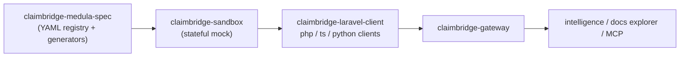

# claimbridge-medula-spec

Language-neutral, machine-readable, registry-first specification for
Medula-compatible healthcare claim integrations. The first vertical slice
is the core claim workflow:

```text
Hasta Kabul -> Hizmet Kayit -> Fatura Kayit
```

> **Status: v0.1** — canonical registry, validation tooling, generators,
> full CI, and the documentation set are live. See
> [CHANGELOG.md](CHANGELOG.md) and the
> [PRD](docs/CLAIMBRIDGE_MEDULA_SPEC_PRD.md).

## What this repository is

- A canonical YAML registry of Medula-compatible services, methods, DVOs,
  enums, rules, workflows, and sandbox scenarios — 42 files covering the
  core claim flow.
- A JSON-Schema-validated registry (Draft 2020-12) with generated docs,
  generated Mermaid diagrams, and a versioned
  `dist/claimbridge-medula-spec.json` bundle guarded by checksums.
- Source-provenance-first: every entity links back to a source reference
  with an explicit confidence and review status
  (`draft | reviewed | deprecated`).
- The contract source for future ClaimBridge projects — they consume the
  generated bundle instead of hardcoding Medula behavior.

## What this repository is not

- Not a live SGK/Medula connector, SOAP server, or sandbox runtime.
- Not a Laravel/PHP package and not an HBYS product.
- Not affiliated with, endorsed by, or maintained by SGK — see
  [DISCLAIMER.md](DISCLAIMER.md).
- Contains no real patient data or credentials; examples are synthetic-only.

## Architecture



## Repository layout

| Directory | Purpose |
|---|---|
| `sources/` | Official source manifest, guide versions, WSDL manifest, extraction notes |
| `schemas/` | JSON Schema (Draft 2020-12) for every registry entity |
| `registry/` | Canonical YAML registry: services, methods, dvos, enums, rules, workflows, scenarios |
| `examples/` | Synthetic request/response examples |
| `docs/` | Hand-written overviews (00-05) plus `docs/generated/` reference docs |
| `diagrams/` | Generated Mermaid diagrams (`er-diagram`, `core-flow`, `service-map`) |
| `tools/` | TypeScript validation & generation CLI ([tools/README.md](tools/README.md)) |
| `tests/` | Vitest suite: schemas, references, registry data, flows, generation, CI, docs |
| `dist/` | Generated spec bundle + manifest (committed; freshness guarded by `pnpm check`) |

## Quick start

```bash
pnpm install --frozen-lockfile
pnpm validate   # full PRD 19.1 pipeline: schemas, references, synthetic guard
pnpm test       # vitest suite
pnpm generate   # write dist bundle + manifest, docs/generated, diagrams/generated
pnpm check      # validate + regenerate + byte-compare; fails on stale outputs
pnpm format:check
```

## How to validate

`pnpm validate` loads all 42 registry files and runs three stages:

1. **schemas** — every YAML file against its JSON Schema (PRD §20.1).
2. **references** — id resolution across the whole registry, draft-only
   null contracts, `enumRef` contract, WSDL manifest, source references
   (PRD §20.2).
3. **synthetic-examples** — high-signal guard against real identity values,
   non-placeholder credentials, and log files (PRD §20.5).

Any issue exits non-zero with a per-file message.

## How to generate

`pnpm generate` writes the dist bundle and manifest with sha256 checksums
(PRD §18.1), the five generated Markdown documents (§18.2), and the three
Mermaid diagrams (§18.3). Generated outputs are committed (§18.4); `pnpm
check` regenerates in memory with the committed timestamp and fails if any
committed output is stale.

## How future projects consume this spec

`claimbridge-sandbox`, `claimbridge-laravel-client`, and
`claimbridge-gateway` load `dist/claimbridge-medula-spec.json` as their
contract instead of hardcoding Medula behavior (PRD §3, §30). The sandbox
resolves methods, DVOs, rules, workflows, and scenarios from the bundle and
implements stateful behavior on top of it — see
[docs/04-sandbox-contract.md](docs/04-sandbox-contract.md).

## Development workflow

Implementation happens in small work groups following
**TDD → branch → commit → PR** (PR only when a Git remote exists), with a
dated `CHANGELOG.md` entry per group — see PRD §28. Groups 0-8 delivered
v0.1.

## Documentation map

| Document | Content |
|---|---|
| [docs/00-overview.md](docs/00-overview.md) | Domain context, why spec-first, provenance |
| [docs/01-domain-model.md](docs/01-domain-model.md) | The nine registry entities |
| [docs/02-versioning.md](docs/02-versioning.md) | Spec SemVer, guide versions, review status |
| [docs/03-workflows.md](docs/03-workflows.md) | Core claim flow and state effects |
| [docs/04-sandbox-contract.md](docs/04-sandbox-contract.md) | How the sandbox consumes this spec |
| [docs/05-code-generation.md](docs/05-code-generation.md) | Future codegen targets |
| [docs/generated/](docs/generated/) | Generated reference docs (do not edit) |

## Disclaimer summary

This project is not affiliated with, endorsed by, or maintained by SGK or
the official Medula system. It does not provide legal, medical, regulatory,
reimbursement, or billing advice. See [DISCLAIMER.md](DISCLAIMER.md).

- Publicly available reference: the official guide PDF is downloadable without credentials
  from medula.sgk.gov.tr — verified during the Group 9-30 verification passes.

## Source policy

- Official PDF/WSDL artifacts are **not vendored**; only URLs, fetch dates,
  version metadata, and hash fields are stored (PRD §16.3).
- No real T.C. identity numbers, credentials, or production logs — ever
  (PRD §17); the synthetic guard fails CI on violations.

## Naming

The repo name uses "medula" descriptively for compatibility and
interoperability targeting — the DISCLAIMER covers non-affiliation. The
ClaimBridge prefix ties this spec to its downstream ecosystem (sandbox,
clients, gateway). Naming alternatives were evaluated against the PRD §10
list and the current name was retained (see CHANGELOG Group 34).

## License

[MIT](LICENSE).
